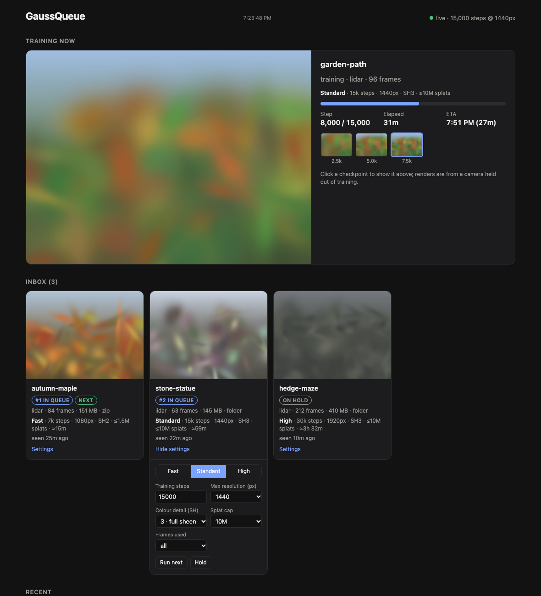

# Note for Humans
This is some AI vibe-coded foolishness so uh, clone at your own risk.

# GaussQueue

A folder-watching training queue for Gaussian splats on a Mac.

Drop a capture into an inbox folder (an iCloud Drive folder works well, so you
can send captures from your phone), and GaussQueue copies it to local disk, trains
it with [Brush](https://github.com/ArthurBrussee/brush) on the Mac's GPU, and puts
the finished `.ply` in an outbox folder. You can follow along on a localhost dashboard, in a
`STATUS.txt` file, or by iMessage.



It was built for [SplatKing](https://radiancefields.com/platforms/splatking) LiDAR
captures, which ship with camera poses as a COLMAP model, so there is no
structure-from-motion step. Any capture that contains a COLMAP model
(`sparse/0/cameras.{txt,bin}` next to an `images/` folder) should work.

## Features

- **Inbox → work → outbox.** Captures can be zips or folders. Each item has to stay unchanged
  for 30 s before it's picked up, so half-synced iCloud uploads are left alone.
  Training happens in a local `work_dir`, and only results go to `outbox_dir`.
- **Instant thumbnails.** When a new item arrives, the middle frame is read straight out
  of the zip or folder (no unpacking) and rotated upright using the capture's
  orientation metadata.
- **Dashboard** at `http://127.0.0.1:8765`. It shows live progress, the checkpoint
  previews (renders from a camera held out of training), the queue and recent results.
- **Per-capture quality settings.** Fast / Standard / High presets, or set the steps,
  resolution, SH degree, splat cap and frame subsampling yourself. Captures can also be
  held or moved to the front. Each queued capture shows an estimated duration.
- **Compressed copies.** Each result also gets `.sog` and `.spz` versions made with
  [SplatTransform](https://github.com/playcanvas/splat-transform). They're typically
  10–15× smaller than the `.ply` and much easier to open on a phone (e.g. in SuperSplat).
- **Pause and tweak.** Pause the running capture: Brush is frozen in place
  (`SIGSTOP`) and the Mac is allowed to sleep. Resume to carry on where it stopped,
  or change its settings while it's paused and resume to restart it from step 0 with
  them. The capture stays on local disk, so nothing is copied again.
- **Notifications (optional).** iMessages when a capture starts, at 25/50/75 % with a
  preview image, and when it finishes or fails.
- **Unattended.** Runs as a launchd agent that starts at login and restarts if it
  crashes. It keeps the Mac awake only while training. When `gaussqueue.py` changes,
  it reloads itself the next time it's idle.

## Requirements

- macOS on Apple Silicon (the pinned Brush build is `aarch64-apple-darwin`).
  It uses the built-in macOS tools `brctl`, `sips`, `caffeinate`, `osascript` and launchd.
- Python 3.9+. The system `python3` from the Xcode Command Line Tools is fine. There are
  no third-party packages.
- Optional: [Node.js](https://nodejs.org) for the `.sog`/`.spz` compression step
  (`brew install node`). Without it, results are `.ply` only.
- For iMessage notifications: the Messages app signed in to iMessage on the Mac.

## Install

```bash
git clone https://github.com/areinot/gaussqueue.git ~/code/gaussqueue
cd ~/code/gaussqueue
scripts/install.sh --inbox "~/Library/Mobile Documents/com~apple~CloudDocs/GaussQueue/inbox"
```

`install.sh`:

1. downloads Brush v0.3.0 and verifies its SHA-256, then, if Node.js is present,
   installs SplatTransform 3.10.1 into a private folder (not a global npm install),
2. writes `~/Library/Application Support/GaussQueue/config.json` from
   [`config.example.json`](config.example.json). By default the outbox and status
   folders go next to the inbox. Pass `--outbox`, `--status` or `--work` to put them elsewhere.
3. runs `gaussqueue.py --check`, then installs and starts the launchd agent.

Re-running is safe; it never overwrites an existing config. To update, run
`git pull` and then re-run `install.sh`. To remove it, run `scripts/uninstall.sh`,
which leaves your data in place.

## Folders

| Setting | Default | What goes there |
|---|---|---|
| `inbox_dir` | *(required)* | Captures to train. Processed items move to `inbox/done/` or `inbox/failed/`. |
| `work_dir` | `~/Library/Application Support/GaussQueue/work` | Unpacked captures and training output. **Keep this out of iCloud.** Note that `~/Documents` *is* in iCloud if "Desktop & Documents Folders" is enabled. Cleaned up after `keep_work_days`. |
| `outbox_dir` | next to the inbox | One folder per capture: `<name>.ply`, `<name>.sog`, `<name>.spz`, `preview.jpg`, `train.log`. Nothing else is written here, so it is safe to share. |
| `status_dir` | next to the inbox | `STATUS.txt` and preview JPGs. Put it in iCloud to check progress from your phone. |

App state (`config.json`, `state.json`, `overrides.json`, `gaussqueue.log`, the Brush
binary) lives in `$GAUSSQUEUE_HOME`, which defaults to `~/Library/Application Support/GaussQueue`.

## Configuration

`config.json` is re-read on every poll, so most changes apply without a restart.
The exception is `dashboard_port`, which needs a restart.

| Key | Default | |
|---|---|---|
| `standard` | 15k steps, 1440 px, SH 3, ≤10M splats | The default preset. *Fast* and *High* are fixed. |
| `compress` | `["sog", "spz"]` | Compressed formats written next to the `.ply`. Use `[]` to turn this off. If compression fails, the capture still counts as done, and the problem is noted in the history. |
| `imessage_to` | `""` (off) | Phone number or Apple ID email to text. |
| `notify_checkpoints` | `[0.25, 0.5, 0.75]` | Fractions of training that trigger a progress text. |
| `settle_seconds` | `30` | How long an inbox item must stay unchanged before it's trained. |
| `checkpoint_every` / `eval_every` | `2500` / `500` | How often Brush saves a checkpoint / renders an evaluation image. Evaluation images drive the progress display. |
| `extra_args` | `[]` | Extra Brush CLI flags, e.g. `["--ssim-weight", "0.3"]`. |
| `brush` | `$GAUSSQUEUE_HOME/bin/brush_app` | Path to a Brush binary you built yourself. |

### iMessage notes

Set `imessage_to`, then run `scripts/notify-test.sh`. macOS will ask once for
permission to control Messages. Image attachments are staged in
`~/Pictures/GaussQueue` (`attach_dir`) because Messages refuses to attach files from
some other locations. If you text the same Apple ID that the Mac is signed in with, the
phone may receive the message silently. Texting a different handle, such as your phone
number, makes sure it alerts.

## Dashboard API

The dashboard listens on `127.0.0.1` only.

- `GET /api/status` returns a JSON snapshot: the current job, the queue with settings
  and estimates, history and presets.
- `POST /api/item` changes a queued item. Example bodies:
  `{"name": "...", "action": "preset", "value": "fast"}`,
  `{"name": "...", "action": "set", "key": "max_resolution", "value": 1920}`, and the
  actions `run_next`, `hold` (with `"value": true|false`) and `reset`. For the running
  capture, `pause` and `resume` are available, and settings can only be changed while it's paused.
  Requests must come from the dashboard's own origin and be JSON. That stops other
  websites open in your browser from changing your queue.

## Limitations

- Video or photo-only captures (no COLMAP model) are not trained yet. They would need
  frame extraction and COLMAP. Video zips get a thumbnail only if `ffmpeg` is installed.
- If the Mac restarts, the job that was running starts again from the beginning.
- Brush prints nothing in this mode, so progress comes from its evaluation renders
  (every `eval_every` steps).

## Development

```bash
python3 -m unittest discover -s tests   # dashboard API, presets, queue ordering
GAUSSQUEUE_HOME=/tmp/gq python3 gaussqueue.py --check
```

`gaussqueue.py` is a single file that uses only the standard library, and
`dashboard.html` is plain HTML/JS. The service reads the page from disk on every
request, so edits show up on reload.

## License

MIT. Brush is a separate project, licensed under Apache-2.0. GaussQueue downloads
it at install time and does not include it.
