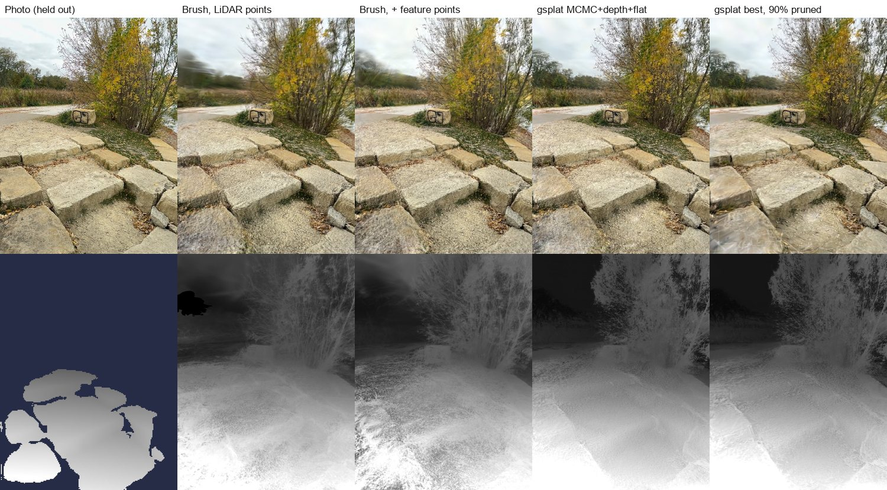
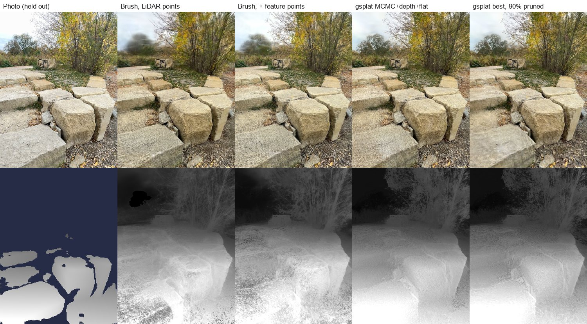
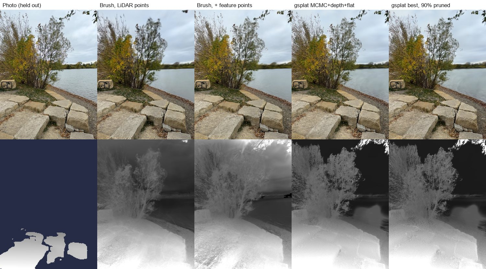
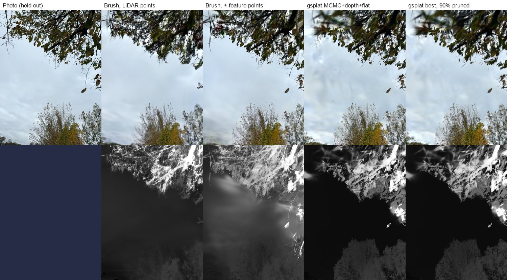
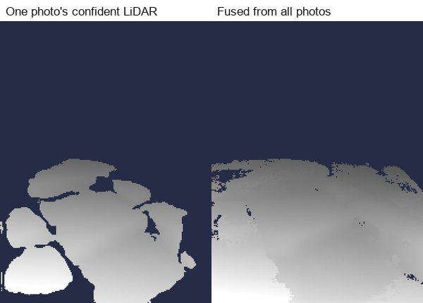
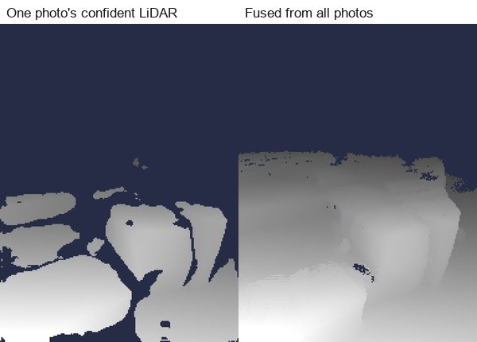

# Trainer and pruning trials

An overnight comparison of Brush and gsplat settings, and of post-training pruning, on one
outdoor capture: 108 iPhone photos with LiDAR depth, taken with SplatKing, a short walk
along stone steps, a willow and a lake shore. The poses were refined with COLMAP. Every run
trained 20,000 steps at 1440 px with a 3M-splat budget on an RTX 4080.

Every 8th photo (13 in all) was **held out**: never trained on, only used for scoring. So
the numbers measure how well each result renders views it hasn't seen.

- **PSNR / SSIM**: how close the render is to the held-out photo (higher is better).
- **Depth error**: median relative error of the rendered depth against the photo's own
  confident LiDAR depth (lower is better). Pixels the render leaves empty count as wrong.

Absolute PSNR is low for every run because several held-out photos are mostly sky or
foliage seen from a moving camera. Compare the runs with each other, not with benchmark
scenes. One capture and one seed per setting: differences under about 0.2 dB are noise.

## Findings

1. **LiDAR depth supervision fixes the geometry.** Median depth error fell from about 41% to
   2–4%, with no loss in image quality.
2. **Starting from COLMAP's feature points helps every trainer.** The LiDAR only reaches
   about 5 m, so distant trees and sky had nothing to grow from and were covered by blurry
   splats near the camera. Adding the triangulated feature points from pose refinement lifted
   Brush from 15.68 to 16.34 dB. GaussQueue now does this by default (`init_feature_points`).
3. **Best gsplat setup: MCMC + LiDAR depth + flatten** (15.85 dB, 1.8% depth error). Brush
   with feature points scores slightly higher PSNR, but its depth is wrong almost half the
   time, which shows up as floaters.
4. **Pruning 70–90% costs almost nothing after a short fine-tune.** The best gsplat result cut
   to 300k splats (90% removed) scored 16.06 dB at 1.9% depth error. SSIM drops a little,
   so the finest texture goes first. LightGaussian scoring beat a probe-based PUP-3DGS
   estimate at every level.
5. **Not worth it here:** 2DGS (4× slower, no better); abs-grad densification; gsplat's
   default densification, which hit the splat cap by step 3,600 and stopped growing.

## Trainers

| Run | PSNR (dB) | SSIM | Depth error | Splats | Train time |
|---|--:|--:|--:|--:|--:|
| Brush, LiDAR points only | 15.68 | 0.321 | 40.2% | 3.0M | 12 min |
| Brush, + feature points | **16.34** | **0.369** | 45.2% | 3.0M | 12 min |
| gsplat, default densify | 15.56 | 0.361 | 41.2% | 3.0M | 14 min |
| gsplat, MCMC | 15.61 | 0.353 | 61.3% | 3.0M | 16 min |
| gsplat, default + depth | 15.74 | 0.358 | 3.9% | 3.0M | 15 min |
| gsplat, default + depth + flatten | 15.65 | 0.350 | 3.1% | 3.1M | 15 min |
| **gsplat, MCMC + depth + flatten** | 15.85 | 0.348 | **1.8%** | 3.0M | 17 min |
| gsplat, abs-grad + depth + flatten | 15.52 | 0.351 | 3.3% | 3.3M | 17 min |
| gsplat, 2DGS + depth | 15.56 | 0.347 | 5.2% | 3.1M | 59 min |

All gsplat runs started from LiDAR + feature points plus a distant "sky shell" of 50k splats.
Depth weight 0.3, flatten weight 10.

## Pruning

Scored on the held-out photos as trained, right after pruning, and after 3,000 fine-tuning
steps (with LiDAR depth). Fine-tuning is what makes deep pruning work.

| Source | Score | Removed | Splats left | As trained | Just pruned | Fine-tuned | SSIM | Depth error |
|---|---|--:|--:|--:|--:|--:|--:|--:|
| Brush + features | LightGaussian | 50% | 1.5M | 16.34 | 15.65 | 15.93 | 0.363 | 4.0% |
| Brush + features | LightGaussian | 70% | 900k | 16.34 | 14.31 | 15.99 | 0.364 | 4.2% |
| Brush + features | LightGaussian | 90% | 300k | 16.34 | 11.75 | 16.03 | 0.340 | 4.4% |
| Brush + features | PUP (probes) | 50% | 1.5M | 16.34 | 15.42 | 15.88 | 0.359 | 5.7% |
| Brush + features | PUP (probes) | 70% | 900k | 16.34 | 13.82 | 15.92 | 0.358 | 5.5% |
| Brush + features | PUP (probes) | 90% | 300k | 16.34 | 10.81 | 15.93 | 0.349 | 6.1% |
| gsplat MCMC + depth + flatten | LightGaussian | 70% | 900k | 15.85 | 14.59 | 15.95 | 0.356 | 2.0% |
| gsplat MCMC + depth + flatten | LightGaussian | 90% | 300k | 15.85 | 12.71 | **16.06** | 0.341 | **1.9%** |

The depth-supervised fine-tune also repairs Brush's geometry (45% → 4% depth error).

PUP here estimates its sensitivity score with random probes of the rendered photos, not the
paper's exact per-pixel CUDA implementation. That may be why it trailed LightGaussian.

## Side by side

Held-out photos. Top row: colour. Bottom row: rendered depth (inverse depth, near is
bright), and under the photo, that photo's own confident LiDAR depth (dark blue = none).






## Multi-view depth fusion (experimental, off)

A follow-up idea: merge every photo's LiDAR depth into one 3D model (a TSDF volume, closer
and more confident readings counting more), then render it back into each photo. That way a
photo taken far from a surface would get depth measured up close from elsewhere. It works as
a fusion: depth coverage per photo rose from 20% to 32%, and on photos left out of the fusion
the fused depth agreed with their own close-range LiDAR to a median of 1.3–1.8%.

 

Training on it was worse, though: MCMC + depth + flatten went from 15.85 to 15.67 dB, and
held-out depth error rose from 1.8% to 24%. Most of that came from views facing the willow and
the tree line. Training with per-photo depth already fuses the LiDAR implicitly, so the only
thing explicit fusion adds is coverage, and the extra coverage taught the model something wrong
in those directions. It stays available as `gsplat.depth_fusion` (off by default) and
`gs/fuse.py`.

## Carving known-empty space (experimental, off)

The same fusion also records which space the LiDAR saw *through*. Two rules used that map:
every 100 steps, remove splats centred in known-empty space and shorten splats whose long
axis pokes into it; and make splats beyond the scanned region thin along the line to its
centre, so distant scenery becomes camera-facing disks instead of needles. On top of the best
setup (MCMC + depth + flatten) this removed 151k splats and shortened 241k over the run, but
scored 15.76 dB at 2.4% depth error against 15.85 dB at 1.8% without it. Renders look about
the same, with slightly calmer sky. With LiDAR depth supervision there are few floaters left
to remove on this capture. The options stay available (`gsplat.carve`,
`gsplat.far_flat_weight`) and off by default.

## Open questions

- **SPZ quantisation.** SPZ stores colour and spherical-harmonics coefficients in a few bits
  each (and positions at 24 bits). How much of the fine view-dependent detail survives, per
  SH band, compared with the float `.ply`? Measure held-out PSNR/SSIM of the `.spz` against
  the `.ply` for the same result.

## Reproducing

```bash
python gs/train.py <capture> --out out --steps 20000 --max-res 1440 --holdout-every 8 \
    --strategy mcmc --max-splats 3000000 --depth-dir <capture>/sensor_data \
    --depth-weight 0.3 --flat-weight 10 --sky-points 50000
python gs/prune.py out/export_20000.ply <capture> --out pruned --keep 0.1 --finetune 3000 \
    --holdout-every 8 --depth-dir <capture>/sensor_data --depth-weight 0.3
```

`<capture>` is a folder with `images/`, a COLMAP text model in `sparse/0/` and SplatKing's
`sensor_data/`. Pass `--points` with a points3D.txt that includes the feature points to match
the runs above.
